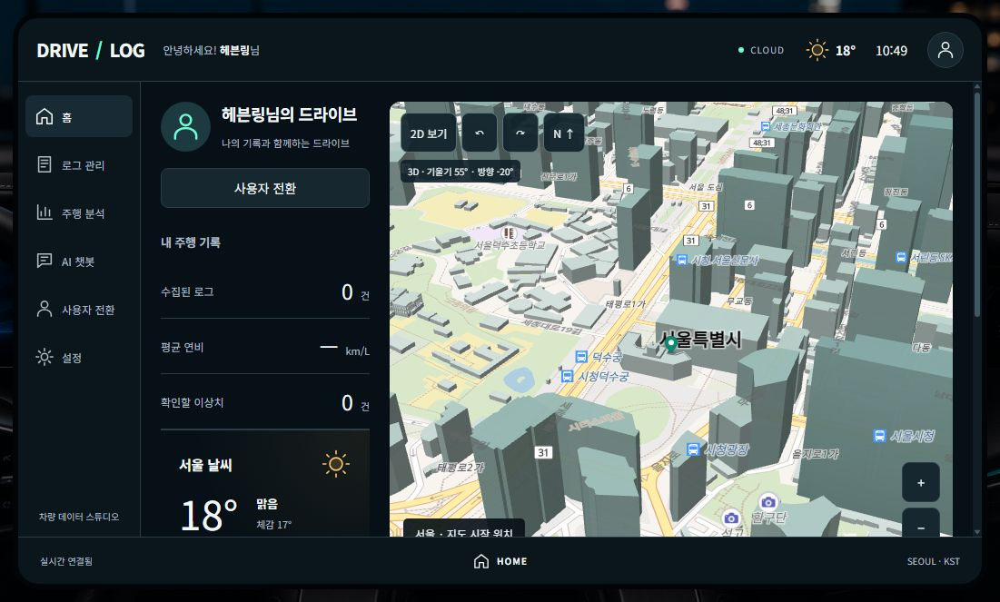
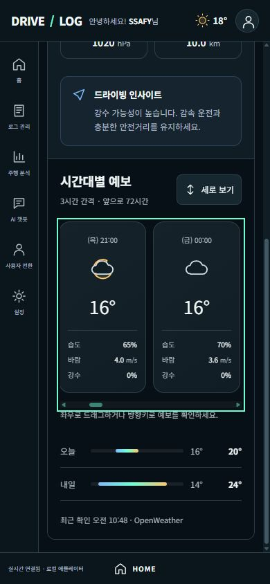

# 3D 지도와 날씨 카드 복구 · 2026-10-15

사용자 요청: 지도 3D 전환, 이전 과정에서 바뀐 날씨 카드의 디자인과 기능 복구.

## 원본과 복구 범위

원본 기준은 infotainment/public/index.html의 날씨 화면·홈 위젯, styles.css의 weather-hero·forecast-card·daily-outlook, app.js의 예보 렌더링·드래그·키보드·자동 갱신입니다. 기존 Vue의 어두운 배경, 민트·앰버 색상, 한글 서체, 계정·로그 화면을 유지했습니다.

| 항목 | 적용 내용 |
| --- | --- |
| 날씨 화면 배치 | 현재 날씨와 시간대별 예보의 두 패널, 모바일에서는 한 열 |
| 현재 날씨 | 도시·날짜·상태별 아이콘·온도·체감온도 |
| 상세 카드 | 습도·바람·기압·가시거리 4종 |
| 드라이빙 인사이트 | 향후 24시간 강수 확률에 따른 기존 안내 문구 |
| 시간대별 카드 | 원본의 24개/3시간 간격, 상태 아이콘·온도·습도·바람, 강수 확률도 유지 |
| 예보 탐색 | 가로/세로 목록, 마우스 드래그, 터치 스크롤, 방향키, 페이지를 오가도 방향 설정 유지 |
| 일별 요약 | 위치의 시간대를 적용한 오늘·내일 최저/최고 기온 범위 |
| 홈·상단 | 날씨 카드·간단 예보 3개·상단 온도와 아이콘 복구 |
| 갱신·오류 | 10분 경과 후 자동 갱신, 수동 새로고침, 요청 취소·시간 제한, 실패 시 마지막 정보와 오류 안내 |
| 지도 | 실제 벡터 건물 높이, 55° 시점, 회전·북쪽·확대·축소, 2D/3D 전환 |
| 검색·길안내 | Kakao 장소 검색·경로 응답을 유지하고 MapLibre 경로선으로 표시 |
| 지도 대체 | 3D 초기화 오류 시 ‘카카오 2D 지도 사용’ 버튼으로 전환, 기존 경로도 복원 |

지도는 MapLibre GL JS 6.14.0과 OpenFreeMap을 사용합니다. 출처 표시는 지도 안에 유지합니다. 3D 건물 정보는 공급 데이터 범위에 따르며 위성 사진이나 포토리얼 건물 모델은 아닙니다. Kakao/OpenWeather 키는 기존 비공개 환경 설정을 사용합니다.

## 검증

- 빌드 통과, 정적 검사 51개 모듈 통과, 단위·HTTP 테스트 46/46 통과.
- 추가 회귀 테스트: UTC 자정과 목적지 시간대, 음수·0도·결측 기온, 같은 최저/최고 범위, 야간·비·눈·안개 아이콘, 24시간 강수 범위, 경로 좌표 순서·빈 경로.
- Chrome 실제 지도: 서울 시청의 3D 건물, 2D 기울기 0°, 3D 기울기 55°, 회전 25°, 북쪽 0° 확인. 지도 캔버스와 컨테이너 높이 566px 일치.
- Kakao 강남역 검색·경로 표시·거리·시간·안내 확인. 검증 당시 약 10.4km/34분. 위치는 공개 기본 좌표이며 장치 위치를 수집하지 않았습니다.
- 날씨 실응답, 예보 24개, 상세 지표와 오늘·내일 범위, 가로/세로 전환 및 화면 이동 후 방향 설정 유지 확인.
- 가로 방향키 scrollLeft 250, 세로 방향키 scrollTop 250, 실제 포인터 드래그 scrollLeft 250→410 확인.
- 390px 화면의 문서 너비 390px, 가로 넘침 없음. 모바일 화면 검증은 인앱 브라우저, 실제 계정·카카오 검색 검증은 Chrome에서 수행했습니다.
- 상위 작업에서 확인한 Firebase/음성 결과는 유지하며 이번 변경은 프런트엔드입니다. GMS 실생성 응답은 기존과 같이 키 부족으로 미검증입니다.

