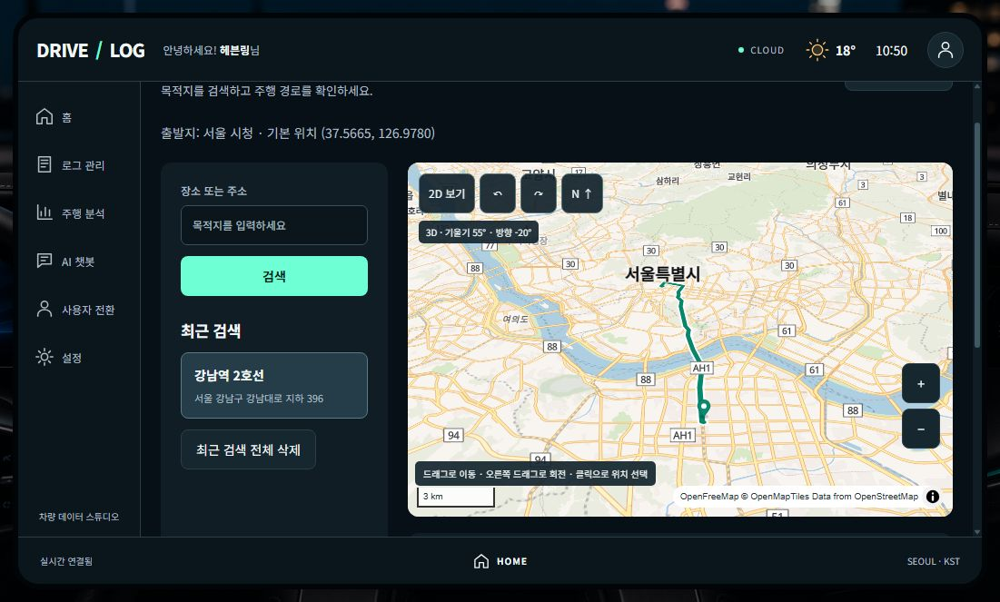
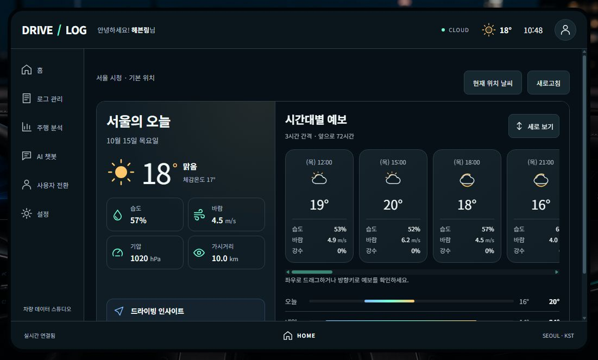
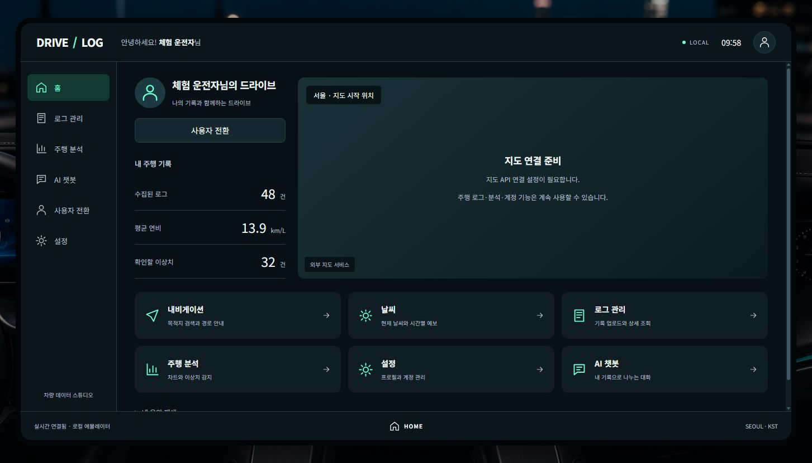
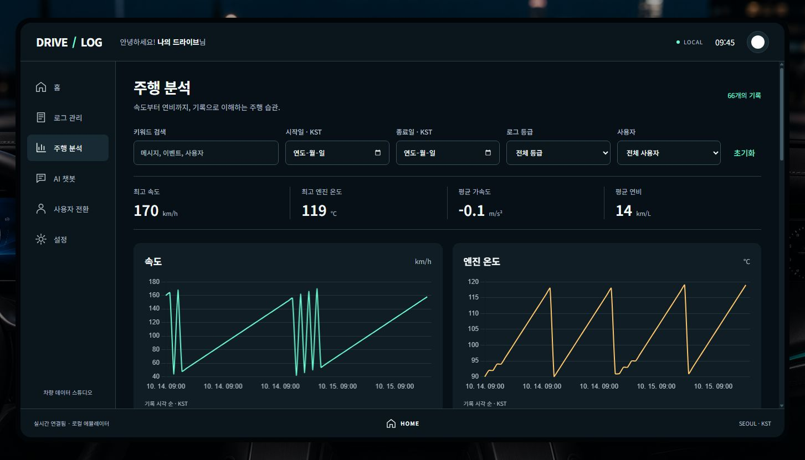
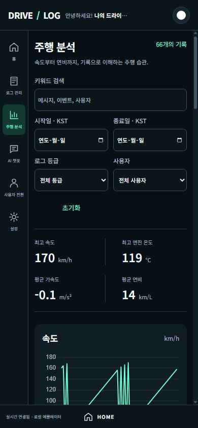
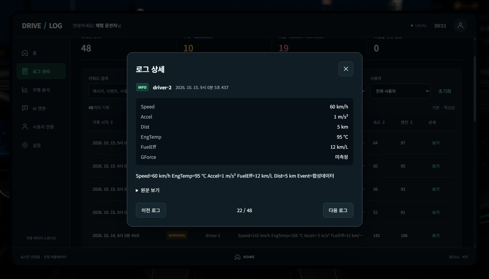
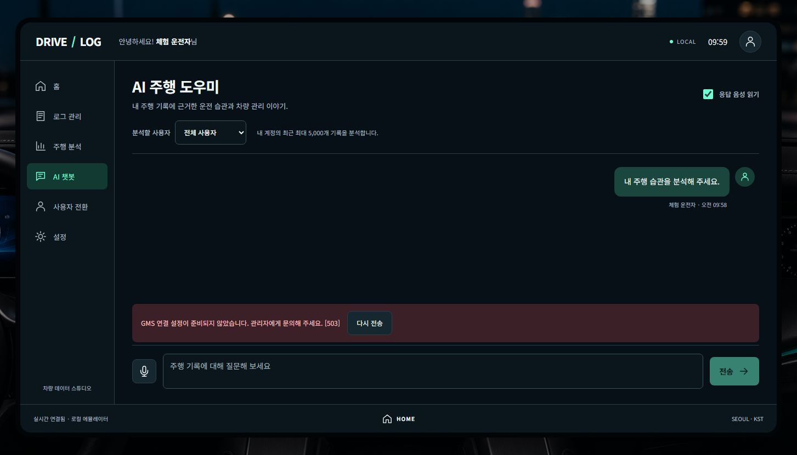
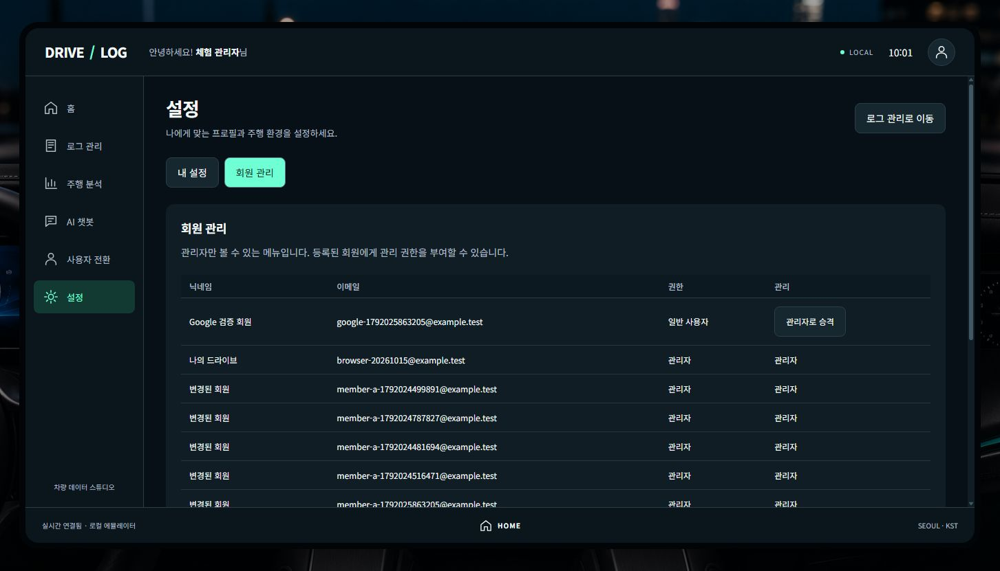
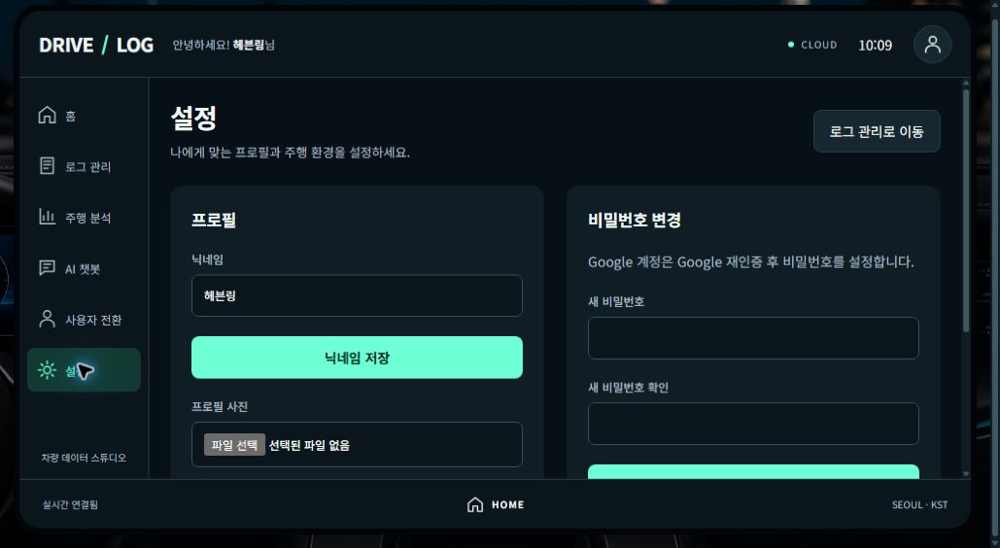

# DRIVE / LOG · PJT2–5 구현 및 검증 결과

검증일: 2026-10-15. 기존 서울 20반 장문수·최현준 프로젝트를 기준으로 확장했습니다.

## 결과

사용자가 지정한 프로젝트와 명세서·강의자료 PDF 8개를 분석하고, PJT2–5의 기본·심화 요구사항 44개를 코드에 반영했습니다. 기존 정적 인포테인먼트 화면을 Vue 3 화면 8개로 옮기고 Firebase 인증, 실시간 로그, 차트, 관리자 기능, AI 대화 경로를 연결했습니다.

코드 구현과 외부 서비스 검증을 구분했습니다. Google 실제 로그인과 서버 프로필 저장을 확인했고, 마이크 문장 인식·스피커 출력은 사용자 정상 확인을 받았습니다. Kakao/OpenWeather의 기존 키를 복구해 지도·검색·길안내·현재 날씨·예보의 실응답까지 검증했습니다. GMS의 실제 생성 응답은 API 키가 없어 검증하지 못했습니다.

## 주요 변경

- 로그: 행별 원문 저장, Firestore 생성 트리거 정제, 실시간 갱신, KST 날짜·등급·운전자·키워드 복합 필터, 정렬·페이지·상세 탐색, 중복 업로드 방지와 실패 재시도.
- 분석: Chart.js 속도·엔진 온도·가속도·연비 차트, 평균·최대·최근 값, 임계치 조정, 과속·과열·급가감속·충격 감지. 결측값과 음수 가속도 보존.
- 계정: 기본 익명 계정, 회원가입·자동 로그인, 이메일 중복 확인, 선택 프로필 인증, Google OAuth, 닉네임·비밀번호·배경·프로필 사진 변경.
- 관리자: 일반 계정에 숨긴 회원 관리 탭, 전체 회원 조회, 서버에서 권한을 확인한 관리자 승격, 최초 관리자 지정 명령.
- 대화: 즉시 말풍선·로딩·시간·스크롤·고정 입력창, 회원 권한 확인, 본인 로그 분석 문맥, Firestore 이력, 요청 ID 기반 재시도, 한국어 STT/TTS.
- 기존 화면: 홈·내비게이션·날씨·음악 UI 유지 및 Vue 이전. 키 미설정 시 연결 안내를 표시합니다.
- 데이터 보호: 로그인 계정과 로그의 운전자 ID 분리, 타 계정 로그·대화 차단, 역할과 대화의 서버 전용 쓰기, 이미지 업로드 제한.

## 자동 검증

| 검사 | 결과 | 확인 범위 |
| --- | --- | --- |
| `npm run build` | 통과 | Vue 프로덕션 자산 생성, 기존 이미지 복사 |
| `npm run check` | 통과 | JavaScript 51개, JSON, HTML ID, 자산 경로, 공유 모듈 |
| `npm test` | 46/46 통과 | 파서·중복·필터·정렬·통계·이상치·AI 요청 규약·음성 이벤트·HTTP·빈 좌표 거부·날씨 날짜/기온/아이콘·3D 경로 좌표 |
| `npm run test:emulator` | 8/8 통과 | 실제 SDK/규칙/트리거/Storage, 인증·권한·프로필·비밀번호·Google 제공업체·대화 이력 |
| `node scripts/cloud-smoke.mjs --run` | 8개 확인 통과 | 실제 Firebase 가입·중복·자동 정제·이미지·권한 차단·초기 관리자·GMS 오류·웹 설정 |
| 실제 Google 로그인 | 통과 | Chrome 세션 유지·회원 UI·서버 제공업체/권한/프로필 |
| 지도·날씨 실제 API | 15/15 통과 | 로컬 2개 서버와 배포 함수의 공개 설정·경로·날씨·예보·빈 좌표 400 및 서버 키 비노출 |
| `git diff --check` | 통과 | 변경 파일의 공백 오류 검사 |

에뮬레이터 Google 검증은 합성 credential을 사용하므로 실제 Google 동의 창 검증을 대신하지 않습니다. AI 성공 응답 테스트는 주입한 테스트 어댑터를 사용하며 제품에서 가짜 AI 응답을 만들지 않습니다. 권한 거부 테스트의 PERMISSION_DENIED 로그는 예상된 결과입니다.

추가 검증에서 빈 좌표와 공백을 0으로 변환해 유효 좌표로 받는 오류를 재현했습니다. 값이 비어 있으면 400 INVALID_COORDINATES로 거부하도록 수정했고, 실제 숫자 0은 허용하는 회귀 테스트를 추가했습니다.

Vite는 Firebase SDK가 포함된 초기 청크 크기 경고를 표시합니다. 차량 배경의 정적 URL 경고는 빌드 후 자산 복사 및 브라우저 표시로 확인했습니다. 둘 다 빌드 실패는 아닙니다.

## Chrome 화면 검증

- 67행 합성 로그 파일을 업로드해 66행 정제, 1행 거부를 확인했습니다. 날짜·등급·운전자·키워드 조합으로 2행을 조회했습니다.
- 통계와 차트 canvas 4개, 등급 배지, 숫자 정렬, 페이지 이동, 상세 이전·다음 탐색을 확인했습니다.
- 회원가입 후 자동 진입, 닉네임 인사 즉시 반영, 프로필 사진·배경 업로드 및 기본 배경 복원을 확인했습니다.
- 기본 계정의 챗봇 제한, 일반 회원의 관리자 탭 숨김, 계정 전환 시 이전 대화 분리를 확인했습니다.
- GMS 미설정 상태에서 사용자 메시지가 즉시 나타나고 오류·재전송이 제공되며 새로고침 후에도 이력이 유지됩니다.
- 390 × 844 화면에서 문서 너비와 화면 너비가 390px로 같고 가로 넘침이 없음을 확인했습니다.
- Kakao 지도 타일·강남역 검색 결과·서울 시청 출발 경로(검증 당시 10.4 km, 약 34분)·경로 선·안내 목록을 확인했습니다. 실제 사용자 위치 대신 공개된 기본 좌표를 사용했습니다.
- OpenWeather 현재 날씨(검증 당시 서울 약 17°C), 예보 40개, 가로·세로 보기 전환을 확인했습니다. 이후 날씨와 경로 값은 실시간 정보에 따라 달라집니다.

### 실제 지도와 날씨

사용자 후속 요청에 따라 실제 건물 높이를 사용하는 3D 지도와 시점 조작을 적용했습니다. Kakao 검색·경로는 유지합니다. 날씨는 원본의 두 패널, 상세 카드, 상태 아이콘, 드라이빙 인사이트, 예보 24개와 드래그·방향키, 오늘·내일 범위, 홈·상단 요약을 복구했습니다. API 응답 40개 중 72시간 예보 24개를 원본처럼 표시합니다. 자세한 복구 범위는 docs/ui-restoration.md에 기록했습니다.





### 홈



### 주행 분석



### 모바일



### 로그 상세



### AI 연결 미설정 처리



## 실제 Firebase

### 관리자 회원 관리



화면의 회원과 주행 기록은 로컬 검증용 합성 데이터입니다.

기존 `drive-log-pjt2-260911-7a90f` 프로젝트를 Chrome에서 복구했습니다. 이메일/비밀번호·익명·Google 제공업체, Storage, Firestore 규칙·인덱스, 서버 함수 7개를 연결했습니다. 실제 클라우드 검증에 생성한 임시 계정과 해당 계정의 데이터는 정리했습니다. 사용자의 기존 데이터를 삭제하거나 덮어쓰지 않았습니다.

배포 지역은 asia-northeast3, 함수 런타임은 Node.js 22입니다. 기본 Storage는 US-EAST1입니다. 배포 후 Artifact Registry 정리 정책 미설정 경고가 있었으며, 실제 배포 함수 호출은 통과했습니다. Hosting은 공개 배포하지 않았습니다.

## 추가 검증과 남은 외부 조건

Google OAuth: 사용자 로그인 완료 후 Chrome에서 새로고침해도 회원 세션이 유지되고, 회원 설정과 챗봇에 접근하며 관리자 탭은 숨겨짐을 확인했습니다. Firebase 서버에서도 google.com 인증, 활성 상태, user 권한, 프로필·공개 디렉터리 저장을 확인했습니다.



음성: 2026-10-15 사용자가 실제 소리와 문장 인식 모두 정상이라고 확인했습니다. 프로젝트 음성 모듈을 불러오는 임시 검사 화면을 제공했습니다. 브라우저 이벤트 기록은 수집되지 않아 실제 장치 결과는 사용자 실기 확인으로 구분합니다. GMS 실생성 응답→음성 출력 전체 연계는 아래 키 복원 후 확인해야 합니다.

| 항목 | 구현·검증 상태 | 필요한 조건 |
| --- | --- | --- |
| 실제 GMS 응답 | 서버 연동·문맥·오류·재시도 구현, 어댑터 검증 통과 | GMS API 키 및 허용 모델. 현재 사용자께서 재발급이 어렵다고 확인하셨습니다. |

지도·날씨 연결은 완료했습니다. Kakao의 기존 무료 쿼터 앱 Infortainment System과 OpenWeather의 Car Information 키를 사용합니다. 로컬 .env와 Firebase Secret Manager를 설정하고 webApi를 재배포했으며, 클라우드 실응답까지 검증했습니다. 기존 키를 재사용했으며 유료 구독이나 새 앱을 만들지 않았습니다.

## 실행 및 인수인계

현재 소스 위치: `C:\Users\SSAFY\Desktop\jms\pjt5\DRIVE-LOG`.

```powershell
npm ci
npm --prefix functions ci
npm run start:local
# 별도 터미널에서 합성 체험 계정 및 로그 생성
npm run seed:local
```

Java 21 이상이 필요합니다. 로컬 앱은 http://localhost:4173 이며 체험 계정은 `demo-member@example.test`, `demo-admin@example.test`, 초기 비밀번호는 둘 다 `Drive-log-demo-123!`입니다. 기본 SSAFY 계정에는 비밀번호가 없습니다. 실제 Firebase는 비공개 설정을 복구한 현재 PC에서 `npm start`로 실행합니다. 상세 설정은 README를 참고하세요.

제출 ZIP에는 Vue·Functions·스크립트·테스트·규칙·설정 예시·검증 문서를 포함합니다. 실제 키·CLI 토큰·서비스 계정·에뮬레이터 데이터·원본 제공 문서·node_modules는 제외합니다. ZIP 내부의 파일 목록과 SHA-256을 생성하고 압축 해제 결과의 바이트를 대조합니다.

44개 기능별 코드 위치와 검증 근거는 [요구사항 표](../docs/requirements.md)에 정리했습니다. Git 커밋·푸시·GitLab 제출은 실행하지 않았습니다.
